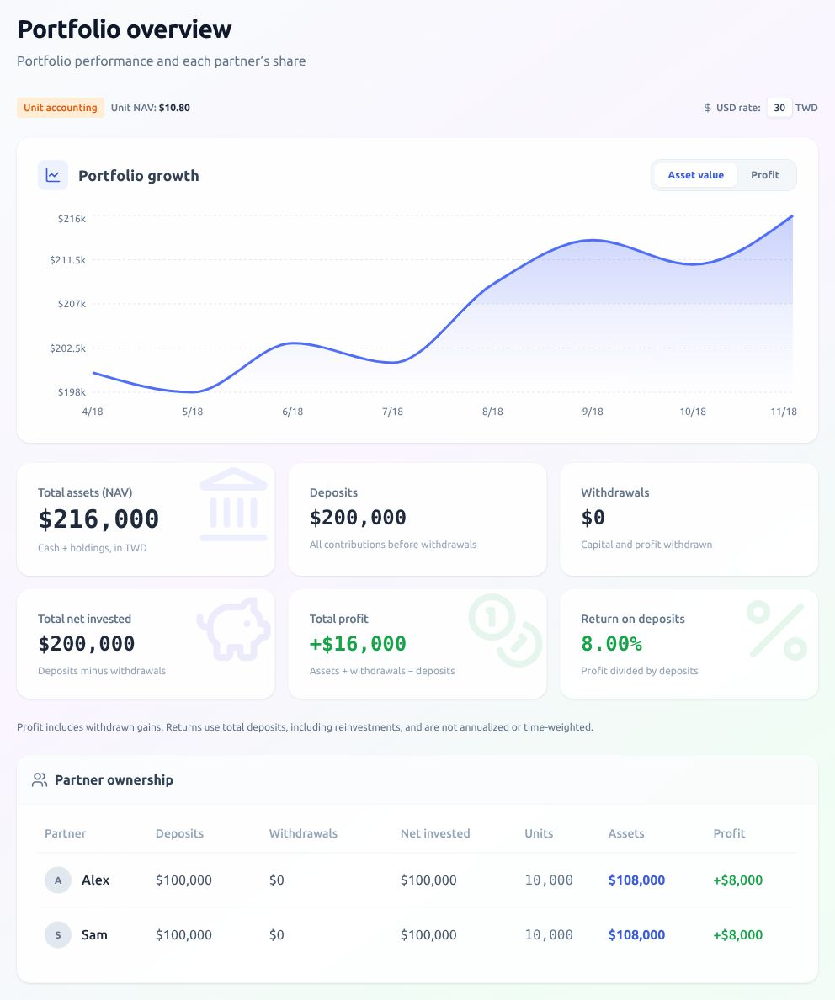

# InvestPartner

**Invest together. Keep the numbers clear.**

InvestPartner is a shared investment tracker for partners. Keep deposits, withdrawals, and stock trades in one place, so everyone can see the portfolio's value, cumulative profit, and their share of the investment.



*English preview with fictional names and sample data. The live app currently uses Traditional Chinese.*

## Your shared investments at a glance

- **The big picture:** See total assets and cumulative profit.
- **Each partner's share:** Track contributions, withdrawals, and current ownership.
- **The history:** Review portfolio growth, holdings, and past trades.

An administrator maintains the records. Authorized partners can sign in to view them.

For calculation details, tests, and daily snapshot setup, see the [maintenance guide](docs/maintenance.md).

## Run locally

Install Node.js 20.19+ or 22.12+, then run these commands in the project folder:

```bash
npm ci
npm run dev
```

Open [http://localhost:5173](http://localhost:5173).

The app currently connects to an existing Firebase project. Adding, editing, or deleting records affects live data. For your own installation, replace the Firebase configuration and administrator account in `src/App.jsx` first.

Website updates follow **GitHub → Vercel automatic deployment**. The Google Apps Script price updater and daily snapshot writer must be updated separately; see the maintenance guide.
